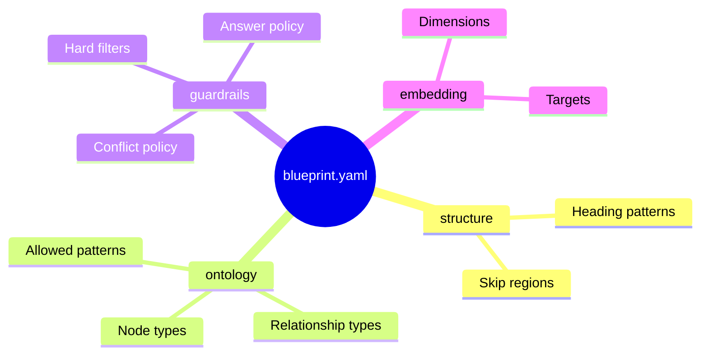
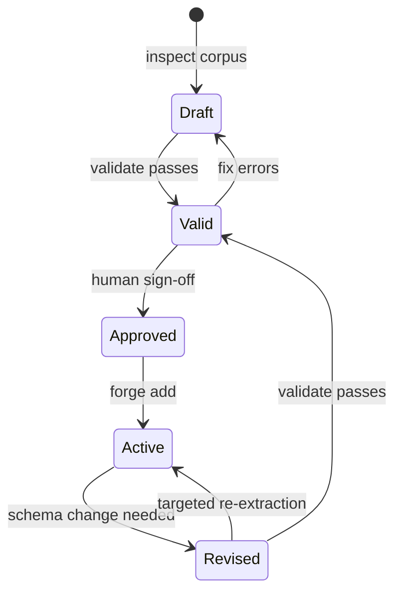

# Blueprint — Overview

<div align="center">
  
</div>

A blueprint is the design document that tells RAGmen what to look for in your corpus. It is the most important decision you make in the whole process — and the cheapest, because it happens before any AI cost is spent.

---

## What a blueprint defines



| Section | What it controls |
|---|---|
| **structure** | How to split your document into chunks (headings, skip regions) |
| **ontology** | What kinds of things and relationships exist in your documents |
| **guardrails** | How the serve layer filters and presents answers |
| **embedding** | Vector dimensions and which fields to embed |

---

## Why you design before you extract

!!! danger "Do not skip this step"

    Extraction calls the AI on every chunk of your document. A 300-page book with 150 chunks at typical pricing costs $3–15 depending on chunk size and model.

    If your schema is wrong — too broad, missing a node type, using the wrong relationship — you discover this when asking questions. Fixing the schema means re-running extraction from scratch.

    The blueprint is the cheap part. Get it right first.

The design workflow is:

```
1. Inspect your corpus (free, offline)
2. List the ten questions your users need answered
3. Design the schema to answer those questions
4. Validate the blueprint (free, offline)
5. Approve and sign
6. Run extraction
```

Steps 1–5 cost nothing.

---

## The one invariant

!!! quote "From AGENTS.md"

    **Forge and Serve make no ontology decisions.** They read a validated blueprint and execute it. If either needs to decide what something *means*, the blueprint is incomplete; fix the blueprint or the spec, never patch around it in Forge.

    Corollary: no domain-specific branching in Forge or Serve code. If you are about to write `if corpus == "legal"`, the spec needs a new field instead.

This means your blueprint is the single source of truth. Every extracted entity, every relationship, every guardrail comes from it — nothing is hardcoded in the engine.

---

## Closed vs open schema

RAGmen requires a **closed schema**: the AI is only allowed to create entities and relationships that are declared in the blueprint.

!!! success "Closed schema (`closed: true`)"

    The AI picks from your declared list. Output is predictable, consistent, and searchable.

    ```yaml
    ontology:
      closed: true
      node_types: [Procedure, Material, Technique, Hazard]
    ```

!!! failure "Open schema (avoid)"

    The AI invents labels freely: "FireStructure", "BuildingTechnique", "WoodType", "DriedGrass"... You end up with thousands of inconsistent labels that poison every search.

---

## Blueprint lifecycle



Once a blueprint is approved and active, you never need to start from scratch if you revise it. Forge re-extracts only the chunks that were processed under the old blueprint hash.

---

## Next steps

<div class="grid cards" markdown>

-   :material-pencil-ruler: **Design a schema**

    ---

    Step-by-step guide to designing node types, relationships, and patterns for your corpus.

    [:octicons-arrow-right-24: Designing a schema](schema-design.md)

-   :material-file-code: **See a complete example**

    ---

    Walk through the firecraft blueprint line by line.

    [:octicons-arrow-right-24: Reference example](reference.md)

</div>
