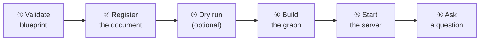

# Your First Graph

<div align="center">
  
</div>

This guide walks you through the complete workflow — from a raw PDF to asking a cited question. We use the example document included with RAGmen (a fire-building manual) so you can follow along immediately.

---

## Before you start

Make sure you have completed [Installation](installation.md):

- [ ] `forge --help` works
- [ ] `docker compose up -d` is running
- [ ] `.env` file has your API key and Neo4j credentials

---

## The workflow at a glance



---

## Step 1 — Validate the blueprint

A blueprint is a YAML file that tells RAGmen what to look for in your documents. The repo includes a working blueprint for the fire-building manual:

```bash
python blueprint/scripts/validate_blueprint.py spec/examples/firecraft.blueprint.yaml
```

Expected output:

```
✓ blueprint is valid
  name: firecraft
  version: 1.0.0
  node types: 4 (Procedure, Material, Technique, Hazard)
  patterns: 5
```

!!! tip

    This step costs nothing — no AI, no database. It just checks that the blueprint file is correctly written. Always do this before adding documents.

---

## Step 2 — Register the document

```bash
forge add "The Complete Book of Fire Building Campfires for Warmth Light Cooking and Survival.pdf" \
  --blueprint spec/examples/firecraft.blueprint.yaml
```

What happens:

1. RAGmen reads the PDF and converts it to clean text (fixing headers, footnotes, hyphenation)
2. The text is split into chunks at chapter and section boundaries
3. Each chunk gets a unique fingerprint based on its content
4. Everything is registered in a local database (`forge.db`)

Expected output:

```
source registered: src-abc123
mime: application/pdf
chunks: 147
blueprint: firecraft v1.0.0
```

Note the **source ID** (`src-abc123`) — you will use it in the next steps.

!!! success "Run it a second time on the same file"

    ```
    unchanged, 0 new chunks  (src-abc123)
    ```

    RAGmen compares the file's fingerprint against the stored one. If nothing changed, it skips everything — zero AI calls, zero cost.

---

## Step 3 — Dry run (optional but recommended)

Before spending any API credits, inspect what will be extracted:

```bash
forge extract src-abc123 --dry-run
```

This writes the prompts to a `dry-run/` folder. Open one to see exactly what the AI will receive — your blueprint's schema plus a chunk of text.

This is also useful for estimating cost before a large extraction run.

---

## Step 4 — Build the graph

Now run the full pipeline:

```bash
forge cook src-abc123
```

This runs five stages in sequence:

| Stage | What it does |
|---|---|
| **Extract** | Sends each chunk to the AI, extracts entities and relationships per the blueprint schema |
| **Resolve** | Merges duplicate entity names ("bow drill" + "bow-drill" → one node) |
| **Embed** | Converts all entities and chunks to vector representations |
| **Write** | Loads everything into Neo4j |
| **Drift report** | Checks for unmapped mentions, hub violations, pattern violations |

Expected output (progress updates as chunks are processed):

```
[  1/147] Chapter 1 / Introduction ... done
[  2/147] Chapter 1 / Tinder ...       done
...
[147/147] Chapter 12 / Safety ...      done

entities written:   84
relations written: 127
chunks processed:  147
drift: 3 unmapped mentions (see drift report)
```

!!! info "If the run is interrupted"

    Press `Ctrl+C` to stop at any time, or let a failure happen. Run the same command again:

    ```
    forge cook src-abc123
    ```

    It resumes from the last completed chunk. You will never pay twice for the same chunk.

---

## Step 5 — Start the retrieval server

Open a **second terminal** and run:

```bash
lattice-serve --store neo4j \
  --blueprint spec/examples/firecraft.blueprint.yaml \
  --neo4j-password password
```

You should see:

```
Lattice Serve starting (store=neo4j)
```

Leave this terminal open. The server is now listening for questions.

---

## Step 6 — Ask a question

In your **first terminal**, run:

```bash
agent ask "how do I build a dakota fire hole?"
```

Example response:

```
The Dakota fire hole is a wind-resistant underground fire structure suited
for cooking and concealment. It consists of two connected holes: the main
fire chamber and a ventilation tunnel that feeds air from the side.

Materials required:
  • dry grass — tinder stage
  • birch bark — kindling stage
  • hardwood — fuel

Hazards:
  ⚠ carbon monoxide risk in enclosed spaces — ensure ventilation

Sources:
  [1] Chapter 2 / Dakota Fire Hole (p. 81)
  [2] Chapter 3 / Ventilation and Safety (p. 94)
```

Every claim is backed by a source and page number. The agent will not invent information that is not in the document.

---

## Things to try

=== "Multi-hop question"

    ```bash
    agent ask "which fire structures have a carbon monoxide hazard?"
    ```

    This requires following two relationships in the graph: structure → hazard. Plain search would miss this.

=== "Conflicting sources"

    If you add a second document that contradicts the first:

    ```bash
    agent ask "what is the best tinder material?"
    ```

    RAGmen surfaces both answers with attribution:

    ```
    Source A (manual.pdf, p.12): dry grass is preferred in dry conditions
    Source B (guide.pdf, p.7): birch bark is more reliable in wet conditions
    ```

=== "Inspect the graph"

    ```bash
    forge list                    # all registered sources
    forge chunks src-abc123       # chunks for a source
    forge status src-abc123       # details and current status
    forge conflicts               # multi-source disagreements
    ```

=== "Remove a source"

    ```bash
    forge retract src-abc123
    ```

    Entities unique to this source are removed. Entities shared with other sources are preserved.

---

## Next step

Ready to use RAGmen on your own documents? The blueprint is the key.

[Blueprint design :octicons-arrow-right-24:](../blueprint/overview.md){ .md-button .md-button--primary }
