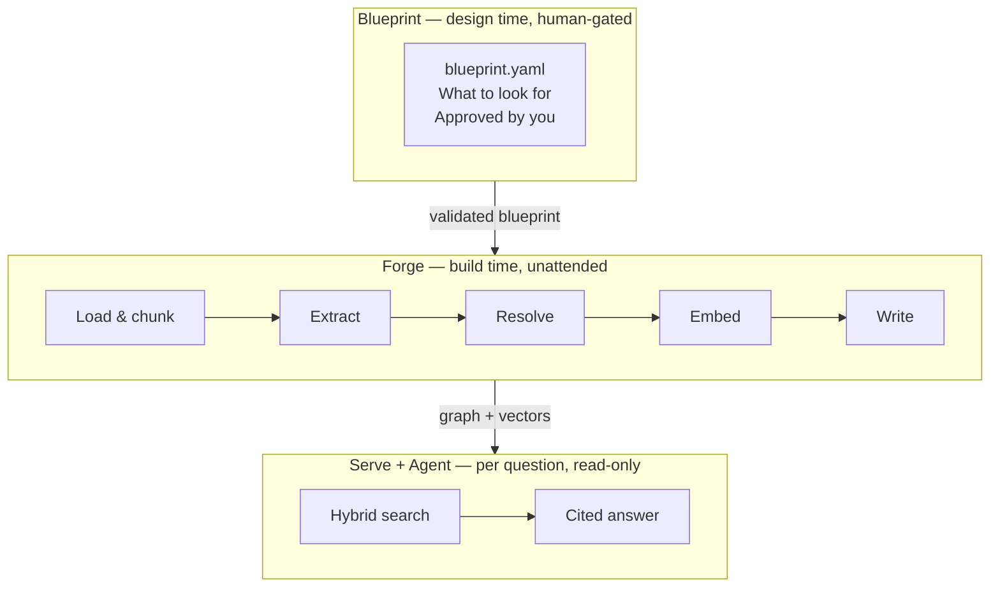

# What is RAGmen?

## The problem

You have documents. A legal archive. A technical handbook. A policy collection. A survival manual. You want to ask questions and get accurate, cited answers.

The simplest approach is to paste everything into an AI and ask. That works for basic questions, but breaks down fast:

!!! failure "What plain AI chat cannot do reliably"

    - **Multi-hop questions** — "Which procedures that require birch bark also have a carbon monoxide hazard?" requires following two relationships across the document.
    - **Citations** — "Where exactly does it say that?" Plain AI often hallucinates sources.
    - **Conflicting sources** — If two documents disagree, AI picks one and sounds confident about it.
    - **Corpus-only answers** — AI mixes in its general training knowledge. You cannot tell which part came from your documents.

RAGmen solves all of these by building a **knowledge graph** — a structured map of facts and relationships — and answering questions by navigating that map.

---

## The cooking metaphor

RAGmen uses a cooking metaphor because building a knowledge graph has the same structure as cooking a meal:

-   :material-chef-hat: **Recipe first**

    ---

    Before you touch your ingredients, you write a recipe. In RAGmen this is the **blueprint** — a schema that defines what kinds of things and relationships exist in your documents.

    You approve the blueprint before any AI cost is spent.

-   :material-pot-steam: **Then cook**

    ---

    **Forge** reads your documents, breaks them into structured pieces, sends them to an AI for extraction, resolves duplicates, and writes everything into a knowledge graph.

    Forge runs once per document and resumes automatically if interrupted.

-   :material-silverware: **Then serve**

    ---

    **Serve** is the read-only window into the graph. It combines vector search, keyword search, and graph traversal to find the best answer — then **Agent** formats it with citations.

---

## The three components

!!! tip "The one invariant"

    **Forge and Serve make no ontology decisions.** They read a validated blueprint and execute it. If either needs to decide what something *means*, the blueprint is incomplete — fix the blueprint, not the code.

---

## What makes it different

| | Plain AI chat | RAGmen |
|---|:---:|:---:|
| Answers strictly from your documents | :material-close: | :material-check: |
| Every claim has a source + page | :material-close: | :material-check: |
| Multi-hop reasoning across relationships | :material-close: | :material-check: |
| Surfaces conflicting sources | :material-close: | :material-check: |
| Re-adding an unchanged file costs nothing | — | :material-check: |
| Interrupted run resumes where it stopped | — | :material-check: |

---

## Who this is for

RAGmen is for anyone with a body of documents they need to query reliably:

- A **law firm** querying a client's contract archive
- A **fire safety instructor** querying a survival manual
- A **policy team** querying government regulations
- A **technical writer** querying a product manual collection

!!! note "Do I need to know how to code?"

    No. You need to be comfortable running commands in a terminal. The guides here walk through every step.

---

## Next step

[Installation :octicons-arrow-right-24:](installation.md){ .md-button .md-button--primary }
