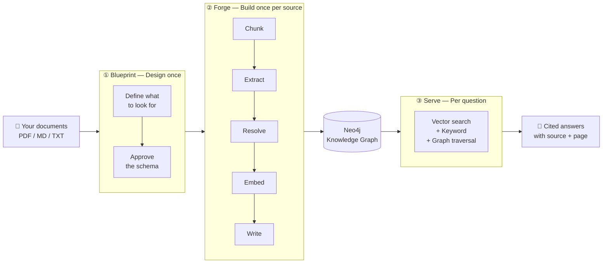

---
hide:
  - navigation
  - toc
description: RAGmen is an open source GraphRAG framework. Turn any PDF or document corpus into a schema-grounded Neo4j knowledge graph and get cited answers via MCP.
---

<div align="center" style="padding: 2rem 0 1rem;">
  
  <h1 style="font-size: 2.8rem; margin: 0.5rem 0 0.2rem;">RAGmen</h1>
  <p style="font-size: 1.25rem; color: var(--md-default-fg-color--light);">
    <strong>Noodles are nodes. Instant GraphRAG without the long cooking.</strong>
  </p>
</div>

<div class="grid cards" markdown>

-   :material-file-document-multiple: **Turn documents into a knowledge graph**

    ---

    Feed RAGmen your PDFs, markdown files, or text documents and it builds a structured map of facts and relationships — not just a pile of chunks.

-   :material-magnify: **Ask questions. Get cited answers.**

    ---

    Every answer comes with the exact source and page number. The AI stays strictly within your documents and never invents information.

-   :material-source-branch: **Multi-source, conflict-aware**

    ---

    When two documents disagree, RAGmen surfaces both versions with attribution instead of silently picking one.

-   :material-lightning-bolt: **Resumable, incremental, content-addressed**

    ---

    Re-adding an unchanged file costs nothing. Interrupted runs resume where they stopped. Only changed sections are re-extracted.

</div>

---

## How it works



---

## Quickstart

=== "1. Install"

    ```bash
    git clone https://github.com/Kamaal404/RAGmen.git
    cd RAGmen
    cd forge && pip install -e ".[dev]" && cd ..
    cd serve && pip install -e ".[dev]" && cd ..
    cd agent && pip install -e ".[dev]" && cd ..
    ```

=== "2. Start the database"

    ```bash
    docker compose up -d
    ```

=== "3. Add a document"

    ```bash
    forge add manual.pdf --blueprint spec/examples/firecraft.blueprint.yaml
    ```

=== "4. Build the graph"

    ```bash
    forge cook src-abc123
    ```

=== "5. Ask a question"

    ```bash
    lattice-serve --store neo4j --blueprint spec/examples/firecraft.blueprint.yaml &
    agent ask "how do I build a dakota fire hole?"
    ```

---

<div class="grid cards" markdown>

-   :material-clock-fast: **New to RAGmen?**

    ---

    Start with the conceptual overview, then follow the step-by-step guide.

    [:octicons-arrow-right-24: What is RAGmen?](guide/what-is-ragmen.md)

-   :material-download: **Ready to install?**

    ---

    Get Python, Docker, and RAGmen set up in 10 minutes.

    [:octicons-arrow-right-24: Installation](guide/installation.md)

-   :material-book-open-variant: **Full command reference**

    ---

    Every command, every option, with examples.

    [:octicons-arrow-right-24: Command reference](reference/forge.md)

</div>
