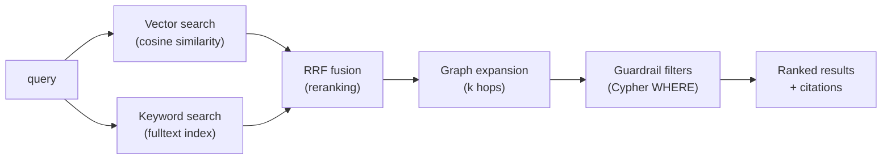

# `lattice-serve` — Command Reference

Lattice Serve is the read-only MCP retrieval server. It never writes to the graph. Start it once and leave it running while users ask questions.

---

## Starting the server

```bash
lattice-serve --store neo4j --blueprint spec/examples/firecraft.blueprint.yaml
```

For development and testing (in-memory, data lost on exit):

```bash
lattice-serve --store memory --blueprint spec/examples/firecraft.blueprint.yaml
```

**Options:**

| Option | Description | Default |
|---|---|---|
| `--store` | `neo4j` or `memory` | `memory` |
| `--blueprint` | Blueprint YAML to load guardrails from | (none) |
| `--neo4j-uri` | Neo4j Bolt URI | `bolt://localhost:7687` |
| `--neo4j-user` | Neo4j username | `neo4j` |
| `--neo4j-password` | Neo4j password | (empty) |

---

## MCP tools

Serve exposes five tools over the [Model Context Protocol](https://modelcontextprotocol.io). These are called automatically by `agent ask`, or you can call them directly from any MCP client.

---

### `search`

Hybrid retrieval: combines vector similarity, keyword match, and graph traversal using Reciprocal Rank Fusion (RRF).

```json
{
  "query": "how do I start a fire in wet conditions",
  "top_k": 10,
  "hops": 1
}
```

| Parameter | Description | Default |
|---|---|---|
| `query` | Natural language query | — |
| `top_k` | Number of results to return | 10 |
| `hops` | Graph traversal depth after initial hits | 1 |

**How it works:**



The guardrails from your blueprint are applied as Cypher `WHERE` clauses before results are returned. Hard filters (like `hazards_always`) cannot be overridden.

---

### `expand`

Explore the neighbourhood of a chunk or entity.

```json
{
  "node_id": "chunk001",
  "hops": 2,
  "top_k": 20
}
```

| Parameter | Description | Default |
|---|---|---|
| `node_id` | Chunk ID or entity ID | — |
| `hops` | Traversal depth | 1 |
| `top_k` | Maximum results | 20 |

Use this when you already know a relevant chunk or entity and want to see what is nearby in the graph.

---

### `cite`

Get the verbatim text, source URI, and page number for a chunk.

```json
{
  "chunk_id": "chunk001"
}
```

Returns:

```
Chunk: chunk001
Path: Chapter 2 / Dakota Fire Hole
Source: manual.pdf
Page: 81
Characters: [4200, 4800)
Blueprint: sha256:b0654b60...

The Dakota fire hole is a wind-resistant underground structure...
```

Every claim in an `agent ask` answer is backed by a `cite` call. The citation includes the exact character range so the source can be verified precisely.

---

### `explain_path`

Show how two entities are connected in the graph.

```json
{
  "source_label": "Procedure",
  "source_name": "dakota fire hole",
  "target_label": "Hazard",
  "target_name": "carbon monoxide",
  "max_depth": 4
}
```

Returns the chain of relationships connecting the two entities:

```
Path found:
  [0] Procedure : dakota fire hole  (start)
  [1] Hazard : carbon monoxide
       └─ HAS_HAZARD  "carbon monoxide is a risk in enclosed spaces"
```

---

### `schema`

Return the active blueprint ontology.

```json
{}
```

Returns the full ontology from the loaded blueprint — node types, relationship types, allowed patterns. Useful for understanding what the graph contains before querying.

---

## How guardrails are applied

Guardrails from the blueprint are compiled to Cypher `WHERE` clauses before any query runs. They are enforced at the database level and cannot be overridden by a user prompt.

| Guardrail type | How it is enforced |
|---|---|
| `force_include` | Result set is expanded to always include matching nodes |
| `restrict` | `WHERE` clause filters nodes the user is not permitted to see |
| `answer_policy` | Passed to the Agent layer as enforced constraints |

This means a safety hazard that is a `force_include` guardrail will appear in every answer that touches its parent entity — even if the user's question did not ask about hazards.
